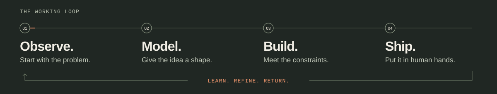
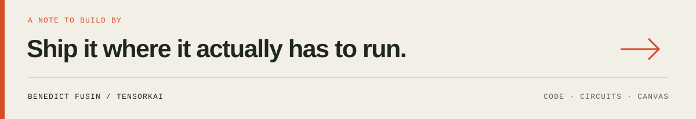

  

  <h3>Benedict Fusin</h3>
  <i>"The model works. But does the product?"</i>

---

I build across the space between a model, a microcontroller, and the person using the product. As an Electronics Engineering student at **PUP Sta. Mesa** and an AI & Edge AI Product Integrator at **Loompoint AI**, my work moves between applied ML, full-stack software, and embedded systems. I get ideas out of the notebook and into the conditions where they actually have to run.

### ✦ On the Workbench
* **Intelligence → product:** Integrating AI and edge-AI features at Loompoint AI.
* **Software → physical world:** Prototyping SecuWear, NodeMCU robotics, and IoT automation.
* **Theory → intuition:** Building MATLAB virtual labs for the 2027 EST Quiz Show.
* **Observation → image:** Making portraits and landscapes—a different medium for the same habit of looking closely.

### ✦ Tools follow the problem
My center of gravity is **Python + C++** for models, pipelines, and hardware; **TypeScript + JavaScript** for web products; and **Flutter + Dart** for mobile surfaces.

<b>Open the tool cabinet</b>

 

| Purpose | Tools |
| :--- | :--- |
| **Train & Explore** | PyTorch, TensorFlow, Hugging Face, LangChain, Ollama |
| **Build the Interface** | React, Next.js, Vue, Flutter, Tailwind CSS |
| **Connect & Store** | Node.js, FastAPI, NestJS, Spring Boot, PostgreSQL, MongoDB |
| **Meet the Hardware** | C++, Python, NodeMCU, MATLAB, embedded systems |

 

  

  <b><a href="mailto:benedictfusin99@gmail.com">Leave a signal ↗</a></b> &nbsp; // &nbsp; <b><a href="https://github.com/tensorkai?tab=repositories">Explore the repositories ↗</a></b>

  

How the observatory stays alive

This cover is drawn from my actual daily GitHub contributions using a custom GitHub Actions workflow. Everything is stored in this repository, including the generator script and automated refresh instructions. Reduced-motion preferences are respected.

