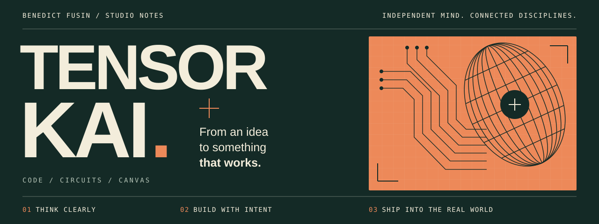
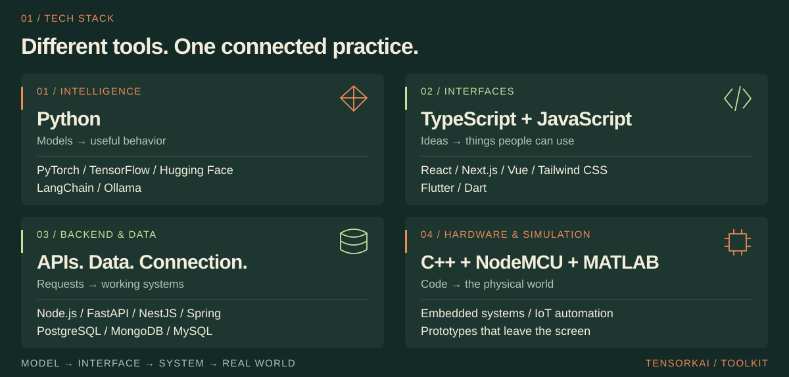

<p align="center">
  
</p>

<p align="center">
  <a href="#01--tech-stack"><b>Tech stack</b></a> &nbsp; / &nbsp;
  <a href="#02--contribution-observatory">Contribution observatory</a> &nbsp; / &nbsp;
  <a href="#03--on-the-workbench">Workbench</a> &nbsp; / &nbsp;
  <a href="mailto:benedictfusin99@gmail.com">Say hello ↗</a>
</p>

**I'm Benedict Fusin.** Electronics Engineering at **PUP Sta. Mesa** · AI & Edge AI Product Integrator at **Loompoint AI**. I connect models, microcontrollers, and the people using the product. Sometimes, I trade the keyboard for a canvas.

## 01 / Tech stack

**Python & C++ for intelligence and hardware. TypeScript & JavaScript for the web. Flutter & Dart for mobile.**

<picture>
  <source media="(max-width: 640px)" srcset="./assets/tech-stack-mobile.svg" />
  
</picture>

<details>
<summary>Every tool, in text ↗</summary>

| Discipline | My toolkit |
| :--- | :--- |
| **Intelligence** | Python · PyTorch · TensorFlow · Hugging Face · LangChain · Ollama |
| **Interfaces** | TypeScript · JavaScript · React · Next.js · Vue · Tailwind CSS · Flutter · Dart |
| **Backend & data** | Node.js · FastAPI · NestJS · Spring · PostgreSQL · MongoDB · MySQL |
| **Hardware & simulation** | C++ · NodeMCU · MATLAB |

</details>

<!-- CONTRIBUTIONS:START -->

## 02 / Contribution observatory

**A year of making, drawn from the source.** Every mark is a day. Every bar is real activity.

<a href="https://github.com/tensorkai#year-list-container">
<picture>
  <source media="(max-width: 640px)" srcset="./assets/contribution-observatory-mobile.svg" />
  
</picture>
</a>

<details>
<summary>Read the numbers / accessible text version ↗</summary>

| Measurement | Reading |
| :--- | :--- |
| Past 365 days | 975 contributions |
| Days active | 95 of 365 |
| Longest streak | 10 consecutive days in this window |
| Past 30 days | 273 contributions |
| Past 7 days | 136 contributions |
| Window | 2025-10-14 → 2026-10-13 |
| Peak day | 38 contributions · 2026-07-28 |
| Latest day | 18 contributions · 2026-10-13 (still in progress) |

**The past seven UTC days**

```text
10-07 Wed  ███████████████░░░   24
10-08 Thu  ███████████████░░░   23
10-09 Fri  █░░░░░░░░░░░░░░░░░    1
10-10 Sat  ██████████████████   28
10-11 Sun  ██████████████░░░░   21
10-12 Mon  ██████████████░░░░   21
10-13 Tue  ████████████░░░░░░   18
```

Counts are GitHub contributions, not just commits. The circular calendar runs clockwise, oldest day at the top. Mark length uses a square-root scale; orange marks exceed 60% of the peak daily count. The weekly skyline groups consecutive seven-day blocks from the window start; the final block is partial. Daily and weekly bars use linear scales. Zero days have no activity bar.

</details>

<sub>Last refreshed: <b>2026-10-13 03:34:59 UTC</b> · Scheduled hourly; GitHub may delay runs.</sub>

[View GitHub contribution calendar](https://github.com/tensorkai#year-list-container) · [Update history](https://github.com/tensorkai/tensorkai/actions/workflows/contribution-observatory.yml)

<!-- CONTRIBUTIONS:END -->

> **“The model works. But does the product?”**<br>
> The question I keep coming back to.

## 03 / On the workbench

Four ways of asking the same question: *what can this become?*

<table>
<tr>
<td width="50%" valign="top">
<sub>03.A &nbsp; / &nbsp; INTELLIGENCE → PRODUCT</sub>
<h3>Beyond the notebook.</h3>
<p>Integrating AI and edge-AI features at <b>Loompoint AI</b>, where models have to become useful product experiences.</p>
<code>applied ML</code> <code>edge AI</code> <code>integration</code>
</td>
<td width="50%" valign="top">
<sub>03.B &nbsp; / &nbsp; SOFTWARE → PHYSICAL WORLD</sub>
<h3>Give the code a body.</h3>
<p>Prototyping <b>SecuWear</b>, NodeMCU robotics, and IoT automation. Making software respond to the world around it.</p>
<code>embedded systems</code> <code>IoT</code>
</td>
</tr>
<tr>
<td width="50%" valign="top">
<sub>03.C &nbsp; / &nbsp; THEORY → INTUITION</sub>
<h3>Make the invisible click.</h3>
<p>Building <b>MATLAB virtual labs</b> for the 2027 EST Quiz Show. Turning abstract ideas into things you can explore.</p>
<code>simulation</code> <code>electronics</code>
</td>
<td width="50%" valign="top">
<sub>03.D &nbsp; / &nbsp; OBSERVATION → IMAGE</sub>
<h3>Keep looking closely.</h3>
<p>Making <b>portraits and landscapes</b>. A different medium for the same habit: notice the details, then make something from them.</p>
<code>portraits</code> <code>landscapes</code>
</td>
</tr>
</table>

**Open on the desk** &nbsp; [IoT roadmap](https://github.com/tensorkai/Internet-of-Things-Roadmap) · [ML for everyone](https://github.com/tensorkai/ml-4-everyone) · [Python practice](https://github.com/tensorkai/All-About-Python)


<br>


---

<p align="center">
  <b>Good ideas deserve a life outside the notebook.</b><br><br>
  <a href="mailto:benedictfusin99@gmail.com">Start a conversation ↗</a> &nbsp; / &nbsp;
  <a href="https://github.com/tensorkai?tab=repositories">Explore the repositories ↗</a><br><br>
  <sub>BENEDICT FUSIN &nbsp; / &nbsp; TENSORKAI &nbsp; / &nbsp; CODE, CIRCUITS, CANVAS</sub>
</p>
