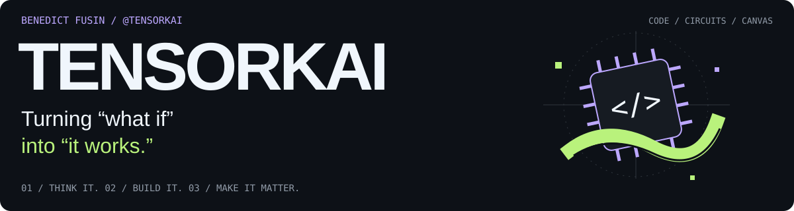
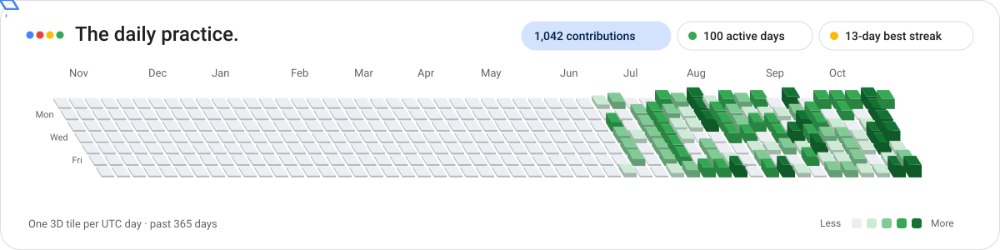

<picture>
  <source media="(max-width: 640px)" srcset="./assets/masthead-mobile.svg" />
  
</picture>

**I'm Benedict. I give ideas somewhere to live:** a model, a microcontroller, a screen, sometimes a canvas. Electronics Engineering at **PUP Sta. Mesa**; AI & Edge AI Product Integrator at **Loompoint AI**.

### On the workbench

- **Intelligence, out in the world.** Bringing AI models into useful products at Loompoint AI.
- **Code with a pulse.** SecuWear, NodeMCU robotics, and IoT experiments that reach beyond the screen.
- **A different kind of resolution.** MATLAB virtual labs, painted portraits, and landscapes. Learning by making things visible.

### Tech stack

<picture>
  <source media="(max-width: 640px)" srcset="./assets/stack-mobile.svg" />
  
</picture>

<!-- CONTRIBUTIONS:START -->

### A little, often. A lot, eventually.

<a href="https://github.com/tensorkai#year-list-container">
<picture>
  <source media="(max-width: 640px)" srcset="./assets/contribution-observatory-mobile.svg" />
  
</picture>
</a>

Behind the squares — activity &amp; freshness

| Measurement | Reading |
| :--- | :--- |
| Past 365 days | 1097 contributions |
| Days active | 103 of 365 |
| Longest streak | 16 consecutive days in this window |
| Past 30 days | 332 contributions |
| Past 7 days | 91 contributions |
| Window | 2025-10-22 → 2026-10-21 |
| Peak day | 38 contributions · 2026-07-28 |
| Latest day | 12 contributions · 2026-10-21 (still in progress) |

One 3D tile per UTC day; weeks in columns, Sunday–Saturday in rows. Height and green intensity: 0, 1–3, 4–9, 10–19, 20+ contributions. Blank cells fall outside the window. The blue scanner and its four-color trail are decorative. Counts include GitHub contributions, not just commits.

Last refreshed: <b>2026-10-21 10:12:07 UTC</b> · Scheduled hourly; GitHub may delay runs.

[View GitHub contribution calendar](https://github.com/tensorkai#year-list-container) · [Update history](https://github.com/tensorkai/tensorkai/actions/workflows/contribution-observatory.yml)

<!-- CONTRIBUTIONS:END -->

**Leave with something:** [IoT roadmap](https://github.com/tensorkai/Internet-of-Things-Roadmap) · [ML for everyone](https://github.com/tensorkai/ml-4-everyone) · [Python practice](https://github.com/tensorkai/All-About-Python)

---

**Have a “what if”? [Let's build the “it works.” ↗](mailto:benedictfusin99@gmail.com)** 
CODE / CIRCUITS / CANVAS — Different tools. Same curiosity.
